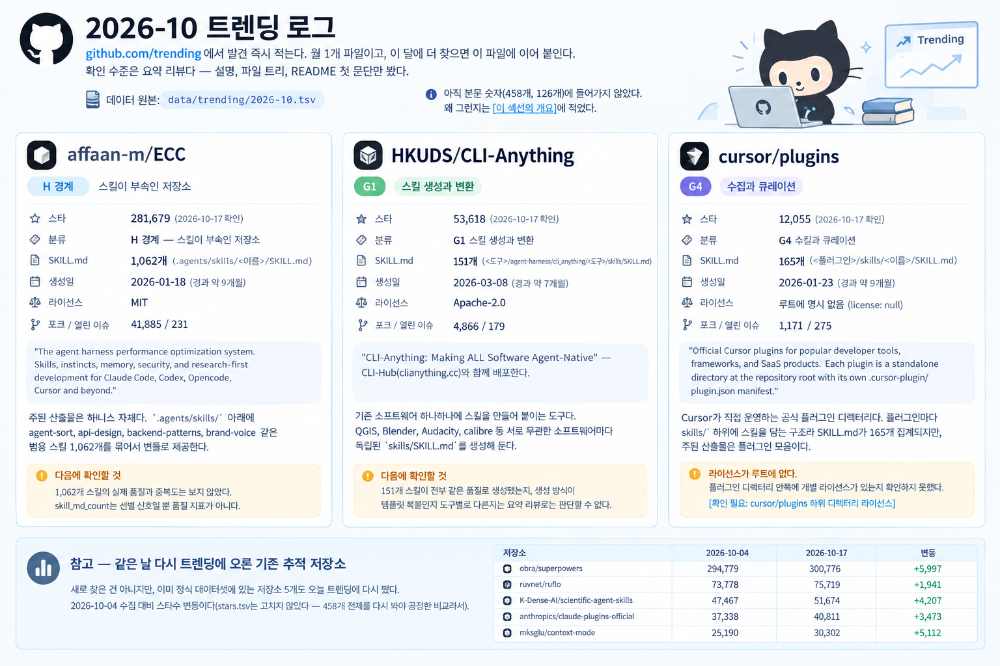

# 2026-10 트렌딩 로그

[github.com/trending](https://github.com/trending)에서 발견 즉시 적는다. 월 1개 파일이고, 이 달에 더 찾으면 이 파일에 이어 붙인다. 확인 수준은 **요약 리뷰**다 — 설명, 파일 트리, README 첫 문단만 봤다. 데이터 원본은 [`data/trending/2026-10.tsv`](../data/trending/2026-10.tsv).

**아직 본문 숫자(458개, 126개)에 들어가지 않았다.** 왜 그런지는 [이 섹션의 개요](README.md)에 적었다.

---

## affaan-m/ECC

| | |
|---|---|
| 스타 | 281,679 (2026-10-17 확인) |
| 분류 | H 경계 — 스킬이 부속인 저장소 |
| SKILL.md | 1,062개 (`.agents/skills/<이름>/SKILL.md`) |
| 생성일 | 2026-01-18 (경과 약 9개월) |
| 라이선스 | MIT |
| 포크 / 열린 이슈 | 41,885 / 231 |

"The agent harness performance optimization system. Skills, instincts, memory, security, and research-first development for Claude Code, Codex, Opencode, Cursor and beyond."

**주된 산출물은 하니스 자체다.** 설명에 나열된 네 요소(skills, instincts, memory, security) 중 하나가 스킬이고, `.agents/skills/` 아래에 agent-sort, api-design, backend-patterns, brand-voice 같은 범용 스킬 1,062개를 묶어서 번들로 제공한다. 타이브레이크 규칙("대상이 스킬 자신이면 G, 스킬이 부속이면 H")을 적용해 H로 분류했다 — 이미 H로 분류된 `ruvnet/ruflo`(에이전트 하니스, 스킬은 부속 기능)와 같은 패턴이다([9부 타이브레이크](../part9/01-star-traps.md), [11.1](../part11/01-taxonomy.md)).

생성 9개월 만에 28만 스타는 이 생태계의 특징("전부 1년 안쪽, 하루 평균 1,364개")과 일치한다([0.1](../part0/01-this-repository.md)). 포크/스타 비율(약 15%)은 봇 스타 의심 신호로 보기엔 평범한 범위다.

**다음에 확인할 것.** 1,062개 스킬의 실제 품질과 중복도는 보지 않았다. `skill_md_count`는 선별 신호일 뿐 품질 지표가 아니다([4.3](../part4/03-scale.md)).

---

## HKUDS/CLI-Anything

| | |
|---|---|
| 스타 | 53,618 (2026-10-17 확인) |
| 분류 | G1 스킬 생성과 변환 |
| SKILL.md | 151개 (`<도구>/agent-harness/cli_anything/<도구>/skills/SKILL.md`) |
| 생성일 | 2026-03-08 (경과 약 7개월) |
| 라이선스 | Apache-2.0 |
| 포크 / 열린 이슈 | 4,866 / 179 |

"CLI-Anything: Making ALL Software Agent-Native" — CLI-Hub(`clianything.cc`)와 함께 배포한다.

**기존 소프트웨어 하나하나에 스킬을 만들어 붙이는 도구다.** 파일 트리를 보면 QGIS, Blender, Audacity, calibre 같은 서로 무관한 소프트웨어마다 독립된 `skills/SKILL.md`를 생성해 둔다. 주된 산출물이 "스킬 생성"이라서 G1로 분류했다 — `yusufkaraaslan/Skill_Seekers`, `titanwings/distilly`와 같은 축이다.

**다음에 확인할 것.** 151개 스킬이 전부 같은 품질로 생성됐는지, 생성 방식이 템플릿 복붙인지 도구별로 다른지는 요약 리뷰로는 판단할 수 없다.

---

## cursor/plugins

| | |
|---|---|
| 스타 | 12,055 (2026-10-17 확인) |
| 분류 | G4 수집과 큐레이션 |
| SKILL.md | 165개 (`<플러그인>/skills/<이름>/SKILL.md`) |
| 생성일 | 2026-01-23 (경과 약 9개월) |
| 라이선스 | 루트에 명시 없음 (`license: null`) |
| 포크 / 열린 이슈 | 1,171 / 275 |

"Official Cursor plugins for popular developer tools, frameworks, and SaaS products. Each plugin is a standalone directory at the repository root with its own `.cursor-plugin/plugin.json` manifest."

**Cursor가 직접 운영하는 공식 플러그인 디렉터리다.** `anthropics/claude-plugins-official`과 같은 패턴 — 특정 도구사가 만든 공식 큐레이션 저장소라 G4로 분류했다. 플러그인마다 `skills/` 하위에 스킬을 담는 구조라 `SKILL.md`가 165개 집계되지만, 이 저장소의 주된 산출물은 "플러그인 모음"이고 스킬은 플러그인 안의 구성 요소다.

**라이선스가 루트에 없다.** `anthropics/skills`가 스킬별 `LICENSE.txt`를 둬서 깃허브가 식별하지 못하는 것과 비슷한 패턴일 수 있다([9.4](../part9/04-licensing.md)) — 플러그인 디렉터리 안쪽에 개별 라이선스가 있는지는 확인하지 못했다. `[확인 필요: cursor/plugins 하위 디렉터리 라이선스]`

---

## 참고 — 같은 날 다시 트렌딩에 오른 기존 추적 저장소

새로 찾은 건 아니지만, 이미 정식 데이터셋에 있는 저장소 5개도 오늘 트렌딩에 다시 떴다. 2026-10-04 수집 대비 스타수 변동이다(`stars.tsv`는 고치지 않았다 — 458개 전체를 다시 봐야 공정한 비교라서).

| 저장소 | 2026-10-04 | 2026-10-17 | 변동 |
|---|---|---|---|
| `obra/superpowers` | 294,779 | 300,776 | +5,997 |
| `ruvnet/ruflo` | 73,778 | 75,719 | +1,941 |
| `K-Dense-AI/scientific-agent-skills` | 47,467 | 51,674 | +4,207 |
| `anthropics/claude-plugins-official` | 37,338 | 40,811 | +3,473 |
| `mksglu/context-mode` | 25,190 | 30,302 | +5,112 |
